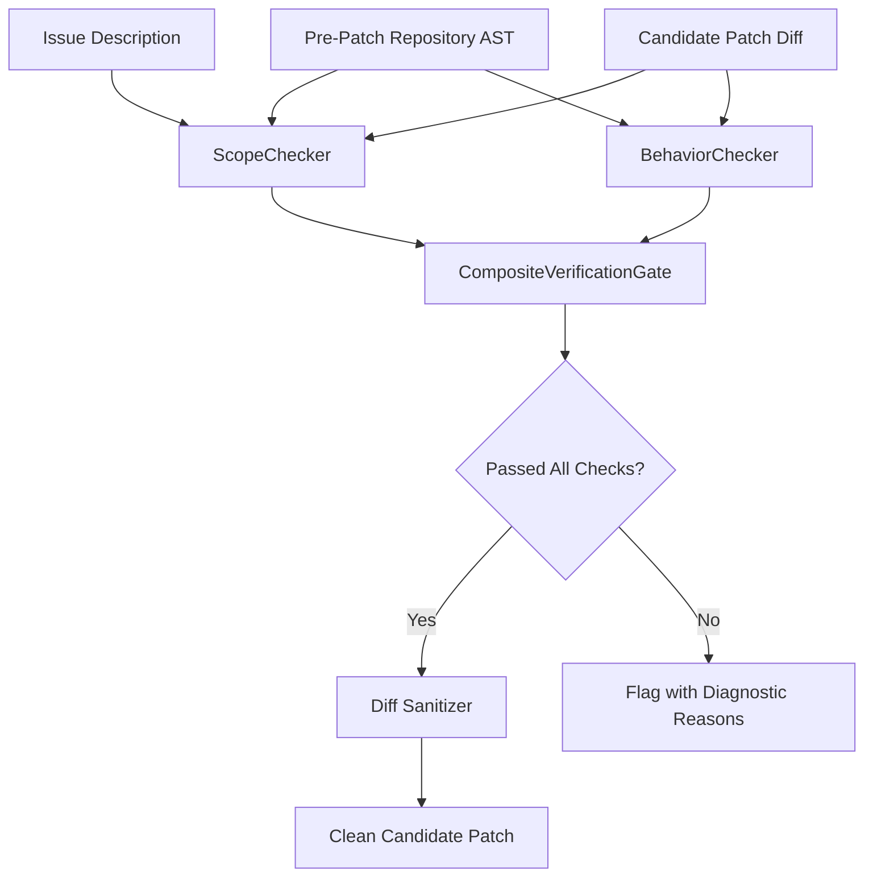

# Oracle-Free Verification Gates for LLM Software Engineering Agents

[](https://www.python.org/downloads/)
[](https://opensource.org/licenses/MIT)
[](https://www.swebench.com/)
[](file:///c:/D_Drive/projects/apr_overfitting_study/tests)

An empirical study and verification framework investigating whether **oracle-free static checks** can reliably detect test-overfitted or behaviorally divergent candidate patches produced by autonomous software engineering agents at generation time without relying on human reference fixes.

---

## 📌 Background & Motivation

Recent autonomous software engineering agents (e.g., [OpenHands](https://github.com/All-Hands-AI/OpenHands), [CodeStory](https://codestory.ai/), [SWE-agent](https://github.com/princeton-nlp/SWE-agent)) resolve real-world GitHub issues by interacting with codebases, synthesizing edits, and iterating against reproduction test suites. On benchmarks such as **SWE-bench Verified**, an agent-generated patch is marked as "resolved" if it passes repository regression tests and issue reproduction unit tests:

$$T_{\text{fail} \to \text{pass}} \land T_{\text{pass} \to \text{pass}}$$

### The Problem: Test Overfitting Without Oracles
Software test suites are incomplete by nature. Recent empirical findings by Wang, Pradel, and Liu (*ICSE 2026*) show that **29.6% of plausible agent patches behave differently from developer fixes** under differential test suites, with a substantial portion introducing latent functional regressions.

Existing differential testing methodologies (such as PatchDiff) identify divergent patches post-hoc by comparing candidate executions against the **developer's reference fix (the Oracle)** inside heavy Docker containers. However, in realistic deployment:
1. **No developer oracle exists** at code-generation time.
2. **Containerized test execution is slow and expensive**, incurring minutes of latency and gigabytes of memory per trial.

### Central Research Question
> *Can lightweight, deterministic checks—using only information available to an agent at generation time (issue description, pre-patch repository state, and candidate diff)—reliably flag suspect or divergent patches before test execution or pull-request submission, and at what cost in false alarms?*

---

## 🏗️ Architecture & Implemented Gates

The framework provides three modular verification gates located in [`gates/`](file:///c:/D_Drive/projects/apr_overfitting_study/gates/):



### 1. `ScopeChecker` ([`gates/scope_checker.py`](file:///c:/D_Drive/projects/apr_overfitting_study/gates/scope_checker.py))
Enforces structural, spatial, and file-level boundaries between the problem description and modified files:
- **Scratch File Leakage**: Detects temporary reproduction scripts accidentally committed to root directories (`reproduce_*.py`, `test_edge_cases.py`, `temp_*.py`).
- **File Mention Scoping**: Parses file references and module paths from the issue text to detect edits outside relevant modules.
- **Test File Tampering**: Identifies unauthorized edits to pre-existing repository unit test suites.
- **Structural Churn Bounds**: Flags abnormal patch volumes (>4 files modified, >250 lines added/deleted).

### 2. `BehaviorChecker` ([`gates/behavior_checker.py`](file:///c:/D_Drive/projects/apr_overfitting_study/gates/behavior_checker.py))
Performs static AST semantic invariant validation on Python code using `tree-sitter`:
- **Public Signature Mutation**: Flags alterations to public function/method parameters, defaults, or return contracts that risk breaking downstream consumers.
- **Defensive Guard Removal**: Detects deleted validation checks (`if x is None: raise ValueError`, `assert ...`), preventing patches from bypassing validation instead of fixing the root cause.
- **Hardcoded Return Cheating**: Flags trivial test cheats (e.g., unconditional literal returns tailored to pass a failing assertion).
- **Silent Exception Suppression**: Detects blanket `try: ... except: pass` blocks masking underlying failures.

### 3. `CompositeVerificationGate` & `Sanitizer` ([`gates/composite_gate.py`](file:///c:/D_Drive/projects/apr_overfitting_study/gates/composite_gate.py), [`gates/sanitizer.py`](file:///c:/D_Drive/projects/apr_overfitting_study/gates/sanitizer.py))
- Combines scope and syntactic gates with configurable rejection thresholds.
- Provides automated pre-submission diff sanitization to strip scratch reproduction scripts from candidate PRs before evaluation.

---

## 📊 Empirical Findings & Per-Rule Ablation

We evaluated the framework on **724 candidate patches** from three state-of-the-art SWE-bench agents (`OpenHands`, `LearnByInteract`, and `CodeStory`) evaluated against differential test suites from PatchDiff ($N = 724$, 260 Divergent, 464 Non-Divergent; Base Divergence Rate = **35.9%**).

### Table 1: Per-Rule Ablation ($N = 724$)
*Wilson score 95% confidence intervals reported in brackets.*

| Rule / Signal | Total Flagged | Divergent (TP) | Recall [95% CI] | Non-Div (FP) | False Alarm Rate (FPR) [95% CI] | Precision [95% CI] | Empirical Assessment |
| :--- | :---: | :---: | :---: | :---: | :---: | :---: | :--- |
| **Scratch File Leaked** | 201 | 70 | 26.9% [21.9%, 32.6%] | 131 | 28.2% [24.3%, 32.5%] | 34.8% [28.6%, 41.6%] | At chance level (hygiene artifact) |
| **Out-of-Scope File Modified** | 229 | 79 | 30.4% [25.1%, 36.2%] | 150 | 32.3% [28.2%, 36.7%] | 34.5% [28.6%, 40.9%] | At chance level (uninformative) |
| **Test File Tampered** | 137 | 54 | 20.8% [16.3%, 26.1%] | 83 | 17.9% [14.7%, 21.6%] | 39.4% [31.6%, 47.8%] | At chance level (uninformative) |
| **Non-Code File Modified** | 60 | 17 | 6.5% [4.1%, 10.2%] | 43 | 9.3% [7.0%, 12.2%] | 28.3% [18.5%, 40.8%] | Weak signal |
| **Excessive Files (>4)** | 35 | 9 | 3.5% [1.8%, 6.5%] | 26 | 5.6% [3.9%, 8.1%] | 25.7% [14.2%, 42.1%] | Weak signal |
| **Excessive Churn (>250)** | 13 | 3 | 1.2% [0.4%, 3.3%] | 10 | 2.2% [1.2%, 3.9%] | 23.1% [8.2%, 50.3%] | Rarely triggered |
| **Public Signature Mutation** | 10 | 5 | 1.9% [0.8%, 4.4%] | 5 | **1.1%** [0.5%, 2.5%] | 50.0% [23.7%, 76.3%] | **High specificity (~1.0% FPR)** |
| **Validation Guard Removed** | 8 | 4 | 1.5% [0.6%, 3.9%] | 4 | **0.9%** [0.3%, 2.2%] | 50.0% [21.5%, 78.5%] | **High specificity (~1.0% FPR)** |
| **Hardcoded Return Cheat** | 1 | 0 | 0.0% [0.0%, 1.5%] | 1 | 0.2% [0.0%, 1.2%] | 0.0% [0.0%, 79.3%] | Infrequent in agent outputs |
| **Exception Suppressed** | 0 | 0 | 0.0% [0.0%, 1.5%] | 0 | 0.0% [0.0%, 0.8%] | N/A | Never triggered |

---

### Table 2: Gate Comparison Against Developer Regression Tests

| Verification Method | Recall on Divergence | Precision | False Alarm Rate (FPR) | Execution Latency |
| :--- | :---: | :---: | :---: | :---: |
| **Composite Static Gate (Raw)** | **47.3%** (123/260) | 34.6% | 50.0% | **10.93 ms** |
| **Composite Static Gate (Sanitized)** | 30.4% (79/260) | 34.5% | 32.3% | **11.45 ms** |
| **Baseline: Developer Regression Tests** | 23.5% (61/260) | **63.5%** | **7.5%** | Minutes to Hours (Docker) |
| **Baseline: Churn > 100 lines** | 8.1% (21/260) | 29.6% | 10.8% | Static |

---

## 💡 Key Empirical Takeaways

1. **Static Rules Cannot Stand Alone for Patch Rejection:**
   Naive static checks flag non-divergent patches at virtually the same rate as divergent patches (50.0% FPR vs 47.3% recall, precision 34.6% vs 35.9% baseline). Rejecting candidate patches solely on broad static boundaries would discard half of all valid agent solutions.
2. **The Commit-Hygiene Phenomenon:**
   **27.8% of all agent patches** (201/724) inadvertently commit scratch reproduction scripts (`reproduce_issue.py`) into repository roots (CodeStory: 32.9%, OpenHands: 26.7%, LearnByInteract: 23.3%). However, this occurs at identical rates across divergent (26.9%) and non-divergent (28.2%) patches. It reflects agent environment hygiene rather than functional defect presence.
3. **High Specificity in Syntactic Guards:**
   Syntactic invariants (signature changes, deleted validation guards) achieve **~1.0% false alarm rates**, making them promising components for hybrid filtering.
4. **Negligible Compute Overhead:**
   Static checks evaluate in **10.93 ms per patch** (7.91 seconds for all 724 patches), compared to minutes-to-hours for Docker test execution. They are ideally suited as **pre-submission sanitizers** and **soft LLM prompt warnings**.

---

## 📁 Repository Structure

```
apr_overfitting_study/
├── gates/                                # Core Verification Gates
│   ├── __init__.py                       # Package exports
│   ├── scope_checker.py                  # Structural scope & file boundaries
│   ├── behavior_checker.py               # AST invariant & contract validation
│   ├── composite_gate.py                 # Multi-stage gate orchestrator
│   └── sanitizer.py                      # Patch diff sanitizer for scratch scripts
├── eval/                                 # Empirical Evaluation Harness
│   ├── evaluator.py                      # Metric computation & benchmark evaluator
│   ├── run_per_rule_analysis.py          # Granular per-rule ablation script
│   ├── check_behavior_flags.py           # AST flag validator
│   ├── PILOT_RESULTS_REPORT.md           # Comprehensive pilot study report
│   ├── per_rule_summary.json             # Per-rule breakdown metrics with 95% CIs
│   └── unified_summary_metrics.json      # Unified benchmark comparison metrics
├── tests/                                # Unit Test Suite
│   ├── test_scope_checker.py             # Unit tests for ScopeChecker
│   ├── test_behavior_checker.py          # Unit tests for BehaviorChecker
│   └── test_composite_gate.py            # Unit tests for CompositeVerificationGate
├── proposals/                            # Research Proposal & Academic Roadmaps
│   └── RESEARCH_PROPOSAL_KHUSHI_SHUKLA.md # Master's research proposal
├── DATA_DICTIONARY.md                    # Data schema and field documentation
├── READING_TABLE.md                      # Systematic literature review (12 papers)
├── RESEARCH_PROJECT_PLAN.md              # Research roadmap and methodology plan
└── README.md                             # Project overview and documentation
```

---

## 🚀 Quickstart & Reproduction

### 1. Prerequisites
- Python 3.10+
- Git

### 2. Installation
```powershell
# Clone the repository
git clone https://github.com/Khushi281300/autoswe.git
cd autoswe

# Create and activate virtual environment
python -m venv .venv
.\.venv\Scripts\Activate.ps1   # On Linux/macOS: source .venv/bin/activate

# Install required packages
pip install tree-sitter unidiff pandas datasets pytest
```

### 3. Run Unit Tests
To verify all gate implementations:
```powershell
python -m pytest tests/
```
Expected output:
```
tests/test_behavior_checker.py ....                                      [ 33%]
tests/test_composite_gate.py ...                                         [ 58%]
tests/test_scope_checker.py .....                                        [100%]
============================= 12 passed in 0.20s ==============================
```

### 4. Reproduce Per-Rule Empirical Ablation
To rerun the full 724-instance offline evaluation and output the Wilson 95% CI ablation table:
```powershell
python eval/run_per_rule_analysis.py
```

---

## 🔬 Academic Roadmap & Ongoing Research

This pilot study forms the foundation of ongoing research on **oracle-free verification gates for autonomous software engineering agents**:
- **Phase 1 (Signal Calibrations)**: Curating a balanced negative set of non-divergent patches on SWE-bench Verified to establish precise baseline specificities.
- **Phase 2 (Hybrid Gate Synthesis)**: Combining high-specificity static invariants with lightweight dynamic test execution and assertion generation.
- **Phase 3 (Agent Repair Loop Integration)**: Deploying calibrated gates into agent execution loops (e.g., AutoSWE, Agentless) to measure their effect on benchmark resolve rate and patch reliability.

For details, refer to the full [Research Proposal](file:///c:/D_Drive/projects/apr_overfitting_study/proposals/RESEARCH_PROPOSAL_KHUSHI_SHUKLA.md) and [Preliminary Pilot Results Report](file:///c:/D_Drive/projects/apr_overfitting_study/eval/PILOT_RESULTS_REPORT.md).

---

## 📚 References & Acknowledgments

- **PatchDiff**: Zhiyu Wang, Michael Pradel, and Tianqi Liu. *"Divergence-Driven Test Generation for Automated Program Repair."* In *Proc. ICSE 2026*.
- **SWE-bench Verified**: Carlos E. Jimenez et al. *"SWE-bench: Can Language Models Resolve Real-World GitHub Issues?"* In *Proc. ICLR 2024*.
- **Specification-Guided Repair**: Jianjun Zhao et al. *"Repairing Neural Network Controllers for Cyber-Physical Systems under System-Level Specifications."* In *Proc. GECCO 2024*.

---

## 📄 License
This project is licensed under the MIT License.
